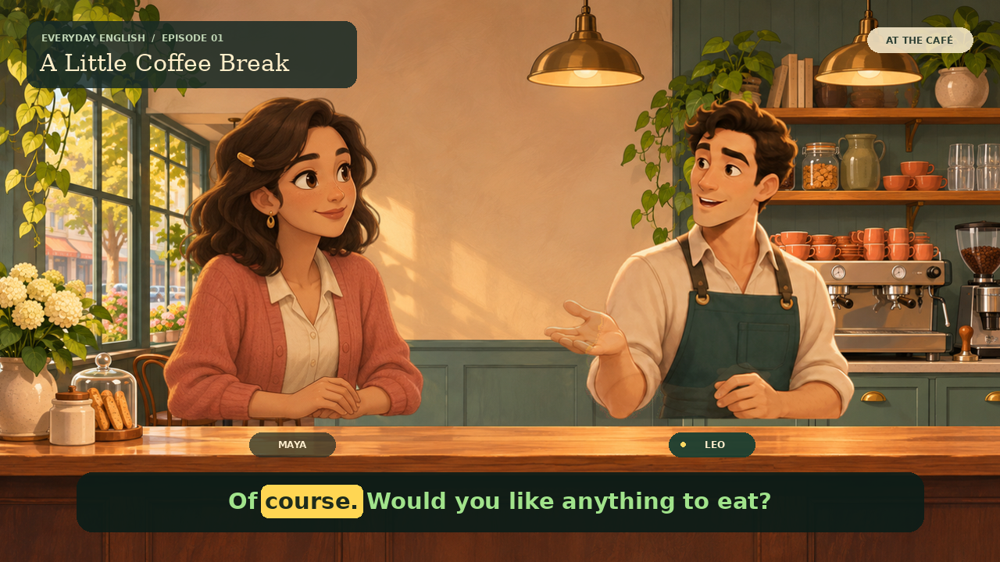

# Extra Material 3 — A Little Coffee Break

A 14-second café conversation starring two original illustrated characters, Maya and Leo. Created in Codex Cloud with two synthesized English voices, speaking gestures, blinks, mouth movement, and green captions with yellow word highlighting.



## Watch and download

- [Video: cafe-conversation.mp4](cafe-conversation.mp4) — 1280 × 720, 24 fps, H.264 video with AAC audio.
- [Reusable project: cafe-animation-project.zip](cafe-animation-project.zip) — renderer, character artwork, dialogue audio, timing metadata, captions, and setup instructions.
- [Subtitles: captions.srt](captions.srt)

GitHub may offer a download button instead of playing the MP4 inline. Download the video to watch it with sound.

## Render the project again

The source is now available directly in [`studio/`](studio/), so you can inspect and change it without unpacking the ZIP. Use Python 3.11+ with FFmpeg installed:

```sh
cd studio
python -m pip install -r requirements.txt
python render.py --output out.mp4
```

The bundled audio and artwork are enough to reproduce the conversation without a GPU or model downloads. The [studio README](studio/README.md) explains how to change the dialogue and generate new voices with Piper. The original ZIP remains an initial-pilot snapshot; use the browsable source and documentation below for continued work.

## Materials for the next developer or AI assistant

| Material | Location |
| --- | --- |
| Start here: how it works, limitations, next steps | [Handoff guide](docs/HANDOFF.md) |
| Tools, versions and production workflow | [Toolchain](docs/TOOLCHAIN.md) |
| Exact artwork prompts and transparency correction | [Asset generation](docs/ASSET_GENERATION.md) |
| Renderer, speech generation, editable episode | [Source code](studio/) |
| Cafe background, character sheets, fonts | [Artwork](studio/assets/) |
| Voices, phoneme/word timings and credits | [Audio](studio/audio/) |
| Model URLs and checksums | [Model manifest](studio/model-sources.json) |
| Download pretrained speech weights | [Voice downloader](studio/setup/download_voices.py) |
| Model cards and voice configurations | [Voice records](studio/voices/) |
| Recorded runtime versions | [Environment records](studio/environment/) |
| Frame overview from the finished pilot | [Contact sheet](studio/contact-sheet.jpg) |
| Optional future remote GPU hardware check | [Kaggle preflight](studio/kaggle/) |
| Guidance for future coding agents | [AGENTS.md](AGENTS.md) |

The model weight files remain on their upstream host and can be downloaded with verified checksums. All final artwork, rendered dialogue audio and source needed to rerender the pilot are checked in. No cloud credentials, package caches, virtual environments or unrelated machine files are included.

## Scope

This is limited 2D animation using eight illustrated poses per character and simplified speech-driven mouth shapes. It does not provide arbitrary full-body actions or editable 3D rigs.

The characters were drawn waist-up. Their lower bodies are absent from the input artwork, and the cafe counter is composited over their bottom edges. The [handoff guide](docs/HANDOFF.md) proposes full-body 2D rigs and Blender 3D rigs as future options. Those improvements are recommendations only; this documentation update does not change the original animation.

The ZIP also includes a private Kaggle GPU preflight notebook and launcher. Kaggle authentication has not been configured, and no Kaggle GPU job has been run. That preflight checks hardware availability; it is not an advanced video-generation model.

Voice sources, font licenses, and tool credits are included in the project archive. No credentials, virtual environments, or model weights are included here.
