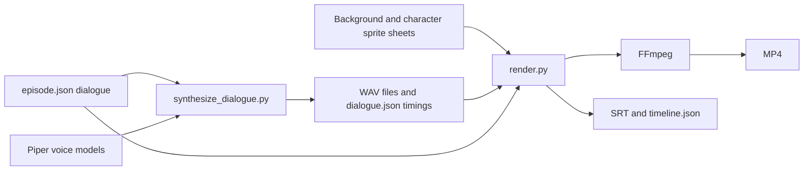

# Animation project handoff

This document records how the uploaded **A Little Coffee Break** pilot was made and what a future developer or AI assistant should know before extending it. The current request authorizes documentation and source upload; the full-body ideas below are proposals, not implemented features.

The delivered pilot is 14 seconds, 1280 × 720, 24 fps, H.264 video with AAC audio. It uses two original illustrated characters, Maya and Leo. The repository's root README identifies the expanded source directory and the downloadable project ZIP.

## What was actually used

| Stage | Actual component | Role |
| --- | --- | --- |
| Character and setting artwork | OpenAI image-generation tool | Generated the café background and transparent character sheets. The exact underlying model identifier and a reproducible seed were not exposed in this session. |
| English voices | Piper 1.8.0, running on CPU | Maya uses `en_US-ljspeech-medium`; Leo uses `en_US-john-medium`. The source includes a checksummed model downloader and voice credits. |
| Speech timing | Piper phoneme-duration alignment | Supplies phoneme intervals and grouped word timings for mouths and highlighted captions. These are model-produced timings, not manually corrected alignment. |
| Animation and compositing | Original Python code using Pillow and NumPy | Selects illustrated poses, animates subtle movement, composites characters and the counter, draws captions, and mixes audio. |
| Video export | FFmpeg | Encodes frames and audio as MP4, normalizes loudness, and enables fast-start playback. |
| Typography | Bundled DejaVu fonts | Used for titles, labels, and captions; font license is included. |

Blender, Rhubarb, ComfyUI, WanGP, InfiniteTalk, MultiTalk, and a Kaggle GPU were **not used to render this pilot**. No animation or language model was fine-tuned. Kaggle tooling in the project is a separate hardware preflight, not a working avatar-generation pipeline.

The existing illustration files let the pilot be rendered again without calling the image-generation service. Creating the illustrations originally used that hosted service; speech synthesis and video compositing ran locally in the cloud workspace on CPU.

## Source flow

### Configuration and speech

`episode.json` defines the title, the intro/turn/outro pauses, and dialogue rows containing speaker, voice, and text. `synthesize_dialogue.py` reads those dialogue rows, runs the two Piper voices, writes `audio/line_XX.wav`, and records word and phoneme timings in `audio/dialogue.json`.

Changing dialogue text requires speech regeneration before rendering. `render.py` consumes the generated WAV files and timing metadata; editing the text field alone does not change existing recorded speech. Changing the configured pauses or title only requires rendering again.

The four pilot lines matched the model's word groups. The synthesis script has an explicitly marked approximate fallback for future lines whose groups do not match. Inspect that metadata when assessing new outputs.

### Character sheets

Each character PNG is a 4-column × 2-row transparent sprite sheet. The eight cells contain **waist-up drawings**, not an articulated character or a complete human body.

| Cell index | Body pose | Facial state |
| --- | --- | --- |
| 0 | Hands resting | Mouth closed |
| 1 | Hands resting | Small speaking mouth |
| 2 | Hands resting | Wider speaking mouth |
| 3 | Hands resting | Closed mouth and blink |
| 4 | Open-palm gesture | Mouth closed |
| 5 | Open-palm gesture | Small speaking mouth |
| 6 | Open-palm gesture | Wider speaking mouth |
| 7 | Open-palm gesture | Closed mouth and blink |

Thus there are two body poses with four facial variants each, not eight independently controllable body actions. Every cell retains a consistent canvas and is resized to 444 × 444 pixels for compositing.

### Rendering details

- `CafeMovie.__init__` reads the episode and dialogue metadata, loads mono PCM16 speech at 22,050 Hz, constructs a timeline, and extracts the sprite cells.
- `mouth` combines an audio-amplitude threshold with simplified phoneme categories to choose closed, small, or wide mouth drawings. It samples at an effective 12 Hz. It is not a complete viseme system.
- `character` crossfades between the resting and open-palm body drawings during each speaking turn. Small vertical movements simulate breathing and nods. Blinks are scheduled at fixed pilot-specific times.
- `frame` composites the scene, adds a gentle camera push-in, draws labels/captions, and highlights the current word from its model timing.
- `export_audio_and_timing` combines the speech with very quiet generated room tone and simple original bell-like tones, then writes SRT and timing metadata.
- `render` streams RGB frames to FFmpeg, which writes H.264/AAC MP4. The built-in command also creates a contact sheet.

## Why the characters appear cut in half

The missing lower body is an **asset limitation**. The character sheets were deliberately generated as waist-up drawings; they contain no pelvis, legs, feet, or unseen lower-body geometry.

The renderer also composites the original counter foreground over the scene from **y = 548 to the bottom**. This hides the bottom edge of the torso illustrations. Adjusting that line or zooming out will expose the edge of the existing artwork; it will not reveal a complete character.

The artwork would have to be extended or replaced before a convincing full-body shot could be made. Simply generating one full-body still would supply a complete appearance, but not the rig or motion data required for walking, sitting, turning, or coordinated hand actions.

## Current limits that matter for reuse

- The renderer expects Maya and Leo and their fixed sheet filenames. The `characters` configuration field does not create arbitrary new cast members.
- Stage coordinates, counter mask, output resolution, captions, and much of the UI layout are fixed for this café composition.
- Captions are rendered as one line at a fixed font size. Long sentences may overflow; wrapping and multi-line layout are not implemented.
- Gesture transitions are crossfades between complete drawings. They may show brief ghosting and do not represent continuous limb articulation.
- The mouth drawings cannot express every phonetic shape. The current sync is approximate visual speech even though the timing data is model-derived.
- Blink times are tuned to the short pilot. Long episodes need a general blink/listener behavior schedule.
- There is no walking, sitting, head-turn rig, depth-aware character interaction, grip/contact system, or multi-angle character geometry.
- New speech can vary slightly because synthesis includes stochastic voice variation. Hosted image regeneration is also not guaranteed to reproduce identical characters.
- Running the renderer rewrites its timing/SRT/contact-sheet outputs. Preserve an episode's directory or commit before regenerating it.

## Full-body options: suggestions only

| Route | New assets/work required | Strength | Main trade-off |
| --- | --- | --- | --- |
| Full-body 2D character rig | Complete artwork separated into head, torso, upper/lower limbs, hands, eyes, and mouth shapes; joint pivots; reusable actions | Retains an illustrated style and can remain suitable for CPU rendering | A single flat image is insufficient; careful layering, rigging, and actions are required |
| Rigged 3D characters in Blender | Complete textured character models, skeletons, facial controls, clothing, scenes, and motion/action library | Strongest control over consistent full-body characters, cameras, foot contact, and repeatable episodes | More asset/setup work; detailed rendering is slower on CPU and may benefit from GPU rendering |
| GPU-generated performances | Full-body references, speech, prompts, a suitable video model, and a tested GPU workflow | Can produce fluid-looking motion without authoring every keyframe | Identity, hands, contact, and continuity can vary; exact acting is less predictable and compute must be provisioned |

For a reusable conversation studio with the same characters across many episodes, **a proper character rig is the most dependable foundation**. Choose a layered 2D rig to preserve this illustration style with modest compute. Choose a full 3D rig if complete-body staging, walking, varied camera angles, and precise gestures are the priority.

A sensible next proof of concept, if the user later requests implementation, is one complete character and one short wide shot: idle, a hand gesture, one spoken line, and stable feet. Confirm the desired look and motion before building a larger action library or replacing the episode pipeline. Existing dialogue configuration, speech synthesis, word timings, subtitles, and FFmpeg delivery can be retained while the animation layer changes.

## Starting instructions for the next developer or assistant

1. Read the root README, this handoff, and the source README. Inspect the actual sprite sheets and existing MP4 before assuming an asset is a rig or a full-body character.
2. Identify the user's current task: reproduction, a new dialogue episode, or a proposed animation-system change. The full-body improvements in this document have not been implemented.
3. Keep the published pilot available as the baseline. Perform experiments in a separate episode/output directory or branch, with explicit filenames.
4. Reproduce a preview using the bundled audio and artwork first. Model downloads are only needed when regenerating speech; Kaggle is not required for the existing renderer.
5. Before a full-body change, specify the intended style, movement, asset contract, and runtime. A waist-up PNG cannot satisfy a skeletal-animation contract.
6. Verify new output at representative frames and speaking turns: no cut edges, no detached feet/hands, consistent scale, readable captions, audio duration, and correct export dimensions.
7. Consult voice/font credits and the recorded model sources when redistributing assets or changing dependencies. Keep credentials and runtime caches out of source control.

